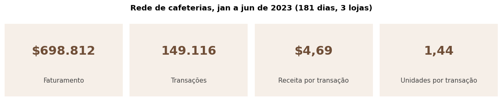
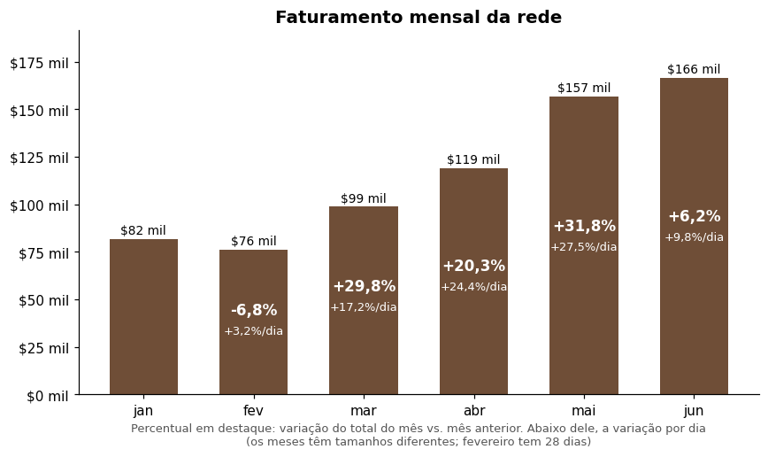
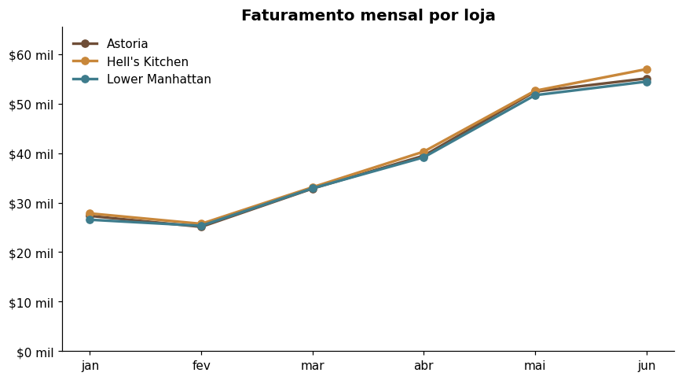
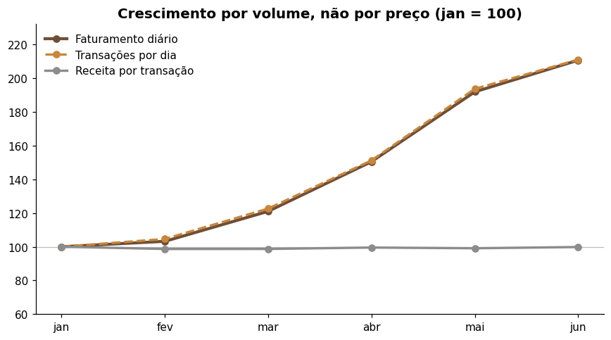

# Análise de uma rede de cafeterias

Análise de cerca de 149 mil transações de 3 lojas de uma rede de cafeterias (janeiro a junho de 2023), com SQL, Python (pandas) e dashboards, para responder se a rede vai bem e por quê.

> **Status:** em andamento. Importação, checagem de qualidade, Pergunta 1 e dashboard interativo prontos; Perguntas 2 e 3 e dashboard em Power BI em construção.

## Perguntas de negócio

1. **Saúde da rede:** como está a rede de cafeterias no geral? Está indo bem ou mal?
2. **Causas:** existe algum motivo para a rede estar indo bem ou mal? O que explica o resultado: volume de pedidos, preço, lojas ou produtos?
3. **Tendência:** qual é a tendência do faturamento diário e existe algum padrão semanal?

## Dados
https://www.kaggle.com

- **Arquivo:** `dados/transacoes_cafeterias.csv` (149.116 linhas e 18 colunas, de 01/01/2023 a 30/06/2023).
- **Lojas:** Astoria, Hell's Kitchen e Lower Manhattan.
- **Colunas principais:** `transaction_id`, `transaction_date`, `transaction_time`, `store_location`, `product_category`, `product_type`, `product_detail`, `transaction_qty`, `unit_price`, `Total_Bill`.
- **Origem:** dataset público de transações de cafeteria usado em cursos de análise de dados. *(Preencher: fonte, link e licença antes de publicar.)*
- **Dicionário de dados:** a escrever (semana 1).
- **Unidade da linha:** cada linha é um item vendido, sem id de pedido. Por isso "receita por transação" é a média por linha, e não o ticket por cliente. A moeda não é informada na fonte; os valores aparecem com `$`.
- **Qualidade:** a base não tem ids duplicados nem valores nulos, e o total da conta é coerente com quantidade × preço unitário. Em 15 produtos o preço unitário varia no mesmo tamanho (por exemplo, biscoitos a 4,06 em vez de 3,25 em 21 linhas).

## Estrutura do repositório

```
analise-cafeterias/
├── dados/        # base de transações em CSV (o banco SQLite é gerado a partir dele)
├── sql/          # consultas SQL: checagem de qualidade, Pergunta 1 e camada de dados do dashboard
├── scripts/      # importação para SQLite e utilitários
├── notebooks/    # análises em Python (pandas)
├── app/          # dashboard interativo (Streamlit)
├── tests/        # conferência dos cálculos contra consultas SQL
├── figuras/      # gráficos exportados pelos notebooks
├── .streamlit/   # tema do dashboard
├── requirements.txt
└── README.md
```

## Ferramentas

SQL (SQLite), Python (pandas, matplotlib, Plotly, Streamlit, Jupyter) e Power BI.

## Como reproduzir

```bash
git clone https://github.com/jucadorea/analise-cafeterias.git
cd analise-cafeterias
pip install -r requirements.txt

python scripts/importar_para_sqlite.py     # cria dados/cafeterias.db (149.116 linhas)
python scripts/rodar_sql.py                # checagem de qualidade (sql/00_checagem_qualidade.sql)
```

- **Notebook da Pergunta 1:** abra `notebooks/pergunta_1.ipynb` e execute todas as células.
- **Dashboard interativo:** `streamlit run app/dashboard.py` (se o banco não existir, o app o cria a partir do CSV).
- **Conferência dos cálculos:** `pytest tests -q`.

## Dashboard interativo

O dashboard reúne os KPIs e os gráficos da Pergunta 1 com filtros na barra lateral:

- **Filtros:** período, loja, categoria, tipo e produto (em cascata), dia da semana e faixa de horário.
- **KPIs:** faturamento, transações, receita por transação, unidades por transação e faturamento por dia, com a variação sobre o período anterior de mesmo tamanho.
- **Evolução no tempo:** por dia, semana ou mês, em faturamento ou transações, com média móvel de 7 dias (dia) ou média por dia (semana e mês).
- **Comparação entre lojas:** em valores ou em participação (%).
- **Decomposição do crescimento:** índice com mês-base à escolha.

Os percentuais mostrados sempre comparam o mesmo valor que o gráfico desenha, e `tests/test_calculos.py` confere os totais, os sinais das variações e os filtros contra consultas SQL diretas.

## Principais achados

### Pergunta 1: a rede vai bem

A rede cresce com força, de forma equilibrada entre as lojas e puxada por volume de vendas.



- **Tendência:** o faturamento mensal foi de $81.678 em janeiro para $166.486 em junho, e o faturamento médio por dia foi multiplicado por 2,1. Fevereiro caiu 6,8% no total, mas tem só 28 dias; por dia, subiu 3,2%. O ritmo desacelerou em junho (+6,2% sobre maio, contra +31,8% de abril para maio).
- **Equilíbrio:** as três lojas ficam entre 32,9% e 33,8% do faturamento e crescem juntas.
- **Origem:** as transações por dia foram multiplicadas por 2,1 e a receita por transação ficou praticamente parada (índice 99,8). O crescimento vem de mais vendas, e não de preço maior.





**Cuidados:** são só seis meses e não há ano anterior, então parte da alta pode ser sazonalidade; sem meta, "bem" significa crescimento em relação a janeiro.

*(Perguntas 2 e 3: a preencher.)*

## Roteiro do projeto

- [x] Importar a base em SQLite e checar a qualidade dos dados
- [x] Pergunta 1: saúde da rede (SQL e pandas)
- [x] Dashboard interativo (Streamlit)
- [ ] Pergunta 2: causas (volume, preço, lojas, produtos)
- [ ] Pergunta 3: série temporal com média móvel de 30 dias
- [ ] Dashboard em Power BI
- [ ] Conclusões e recomendações

## Autor

Juca Dorea de Castro Chaves · [LinkedIn](https://www.linkedin.com/in/juca-dorea/) · [GitHub](https://github.com/jucadorea)
